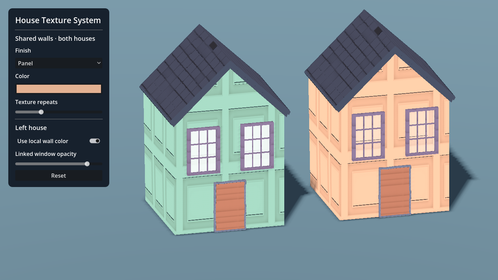

# House Texture System

**Technical art tools · Godot 4.6 · Zmail**

A Godot authoring tool for artists and level designers to restyle modular houses through Inspector controls. Artists can choose a material preset, adjust its color and texture placement, share a finish across buildings, and link repeated parts such as windows.



## Try the demo

Open `project.godot` in Godot 4.6.1, let it import, and press **F5**. This standalone project uses the Compatibility renderer and includes the production house prefab, material scripts, shaders, and texture maps.

1. Change **Finish** from Brick to Panel. Both houses update.
2. Change **Color** or **Texture repeats**. Both houses still share the same settings.
3. Turn on **Use local wall color**. The left house changes color and still follows the shared finish and repeats. Turn it off to restore the shared color.
4. Change **Linked window opacity**. Both windows on the left house update together. The right house keeps its own window settings.

[Starting brick finish](media/01-shared-brick.png) · [Shared panels with a local override](media/02-panel-with-local-color.png)

## How it works

The demo panel exposes a subset of the production workflow. To inspect the authoring controls in Godot, open `scenes/world_objects/buildings/house_two.tscn`, select its root and expand **Building Materials**. Each material slot exposes a texture type and the relevant shader settings. The standalone panel creates a shared wall style when it runs so the two houses start with a predictable comparison.

- **Shared settings.** `BuildingMaterialStyle.set_role_field()` updates a named slot and emits a change. Each connected `BuildingMaterialController` queues a refresh. `resolve_slot_settings()` layers any local fields over the shared slot, so one house can override color while still inheriting texture and UV settings.
- **Repeated parts.** The controller identifies corresponding surfaces using the source scene, mesh path, surface index, and imported surface name. Editing one linked window copies its settings to the matching window inside that house.
- **Rendering.** `BuildingMaterialLibrary.apply()` maps the resolved settings to a surface or glass shader. The controller reuses materials by role and assigns transient per-instance surface overrides through Godot’s rendering server. The texture maps are shared resources, and the imported meshes keep their authored materials on disk. Refreshes are deferred and coalesced when several settings change in one frame.

## Verify

```sh
godot --headless --editor --import
godot --headless -- --smoke
godot -- --capture
```

The smoke check changes the demo controls and verifies shared settings, shader parameters, the local override, linked window isolation, and reset. The capture command renders both screenshots into `media/`.

From **Zmail**, by Garrett McNeill at Wildcat Game Studios.
